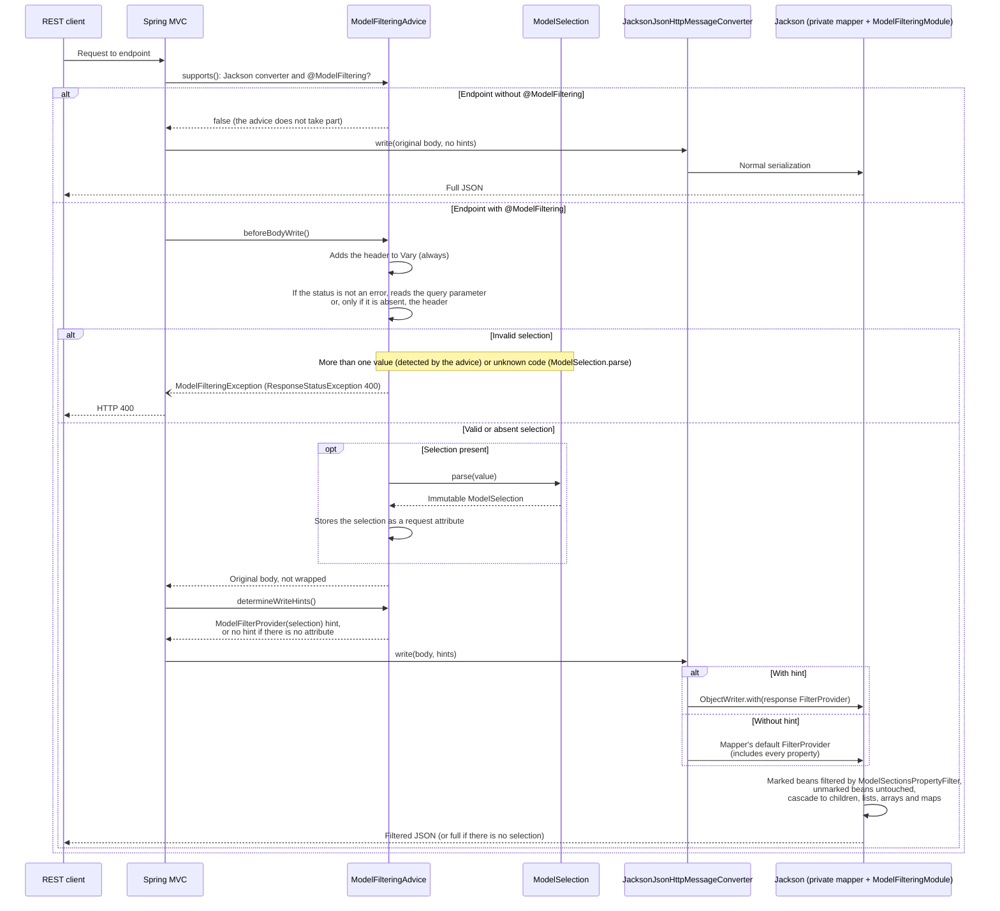

# Model filtering architecture for REST responses

[Català](arquitectura-models-dinamics.md) · **English** · [Español](arquitectura-models-dinamics.es.md)

## 1. Goal and scope

This document describes a reusable architecture that lets a REST consumer select sections of a JSON DTO using compact codes. The service keeps a single response model; the selection is applied during serialization.

The architecture assumes Spring MVC and Jackson, compatible with Java 11 and Spring Boot 2.5.x. It does not depend on a particular controller shape: it works with a plain object, `ResponseEntity`, collections, arrays, maps, pagination wrappers and Spring Data paged values.

> **Spring Boot 4 / Spring Framework 7 / Jackson 3:** the observable contract (sections 2, 4, 7 and 9) is kept, but the internal mechanism of sections 3.3–3.6 changes. See [section 11](#11-adapting-to-spring-boot-4-spring-framework-7-and-jackson-3) and [nova-implementacio.en.md](./nova-implementacio.en.md).

The mechanism is a response presentation policy, not an authorization system nor a query projection. It must not be used to protect sensitive information or to reduce database queries.

## 2. Observable contract

Two independent activations are required:

1. The global property `models.filtratge=true` registers the MVC infrastructure.
2. The endpoint or the controller declares `@ModelFiltering` to opt in.

On an enabled endpoint:

| Selection | Behavior |
| --- | --- |
| Absent from the query parameter and the header | No filtering; Jackson returns the usual full model. |
| Present and empty | Only `@ModelBasic` properties and empty `@ModelSections` are included. |
| One or more valid codes | Basic data and the matching sections are included. |
| Unknown code or repeated value | HTTP 400 error. |

An endpoint without `@ModelFiltering` does not look at the selection and keeps the normal behavior, even if the request contains an incorrect code.

The selection can be sent as a query parameter or as a header. If the request carries both, the query parameter takes precedence and the header is completely ignored (neither applied nor validated). The header is only used when the query parameter is absent.

Existing Jackson rules remain in force: for example `NON_NULL`, `JsonIgnore`, views, property names and additional filters. A basic property with a null value may still be omitted by `NON_NULL`.

## 3. Components and responsibilities

### 3.1 Model annotation contract

Public annotations must stay independent of Spring MVC so that DTOs can be used in clients, messaging or other modules without dragging in the web runtime.

- `ModelPart`: enum of sections, each constant with an explicit name, a stable one-letter code and a description.
- `ModelBasic`: marks a property that is always included in a filtered response.
- `ModelSections`: associates a property with one or more optional sections.
- `ModelFiltering`: opt-in per class or method; allows changing the name of the query parameter (`queryParam`, `m` by default) and of the header (`header`, `X-Model-Sections` by default).

Rule for combining the marks of a property:

| Mark | Explicit selection active |
| --- | --- |
| `@ModelBasic` | Always included. |
| `@ModelSections(A, B)` | Included when the selection contains `A` **or** `B`. |
| `@ModelSections` without codes | Included unconditionally; `@ModelBasic` is recommended for basic fields. |
| No mark, in a bean with some mark | Omitted. |
| No mark in the whole bean | Serialization of all properties is preserved. |

`@ModelBasic` and `@ModelSections` must not be combined on a property. The implementation must detect this incorrect configuration and fail clearly.

Example:

```java
public class PersonaResponse {
    @ModelBasic
    private String id;

    @ModelSections(ModelPart.CONTACTE)
    private List<ContacteResponse> contactes;

    @ModelSections({ModelPart.CONTACTE, ModelPart.RELACIONS})
    private String idiomaComunicacio;
}
```

Marks apply to Jackson properties, not to independent textual JSON names. A convention of field or accessor annotation must be established, without giving contradictory metadata. When the first mark is introduced in a DTO, review all its properties: those left without a mark will be omitted when the filter is active.

### 3.2 `ModelSelection`

It is an immutable value that turns the request text into an `EnumSet<ModelPart>` once per response.

- Repeated codes within a single value are deduplicated (`ccr` is equivalent to `cr`).
- Upper and lower case are not normalized.
- Unknown codes raise a validation exception that the advice translates into a 400.
- It has no HTTP dependencies and no shared mutable state.

The name `m` or `X-Model-Sections` is not part of the parser; the advice passes the value extracted from the transport.

### 3.3 `ModelFilteringAdvice`

A `ResponseBodyAdvice` runs inside the MVC serialization flow, also for `ResponseEntity`. It must:

1. Limit `supports()` to the Jackson converters and to endpoints with `@ModelFiltering`.
2. Resolve the method annotation first and, if there is none, the controller type annotation. Use Spring's annotation utilities so that metadata from interfaces, implemented methods and superclasses is taken into account.
3. Resolve the names of the query parameter and the header.
4. Read the query parameter; only if it is absent, read the header. When there is a query parameter, the header is not validated.
5. If the value is absent, return the original body without wrapping it. This fully preserves the normal Jackson path.
6. If it is present, validate it and wrap the body in a container equivalent to `MappingJacksonValue` that carries an immutable `ModelSelection` instance.
7. Do not replace a Jackson view or `FilterProvider` already carried by a `MappingJacksonValue`.
8. Preserve HTTP error responses and add the header name to `Vary` on every response of the endpoint. Do not remove `Vary` values that are already present.

The header is added to `Vary` even when it is absent from the request: its absence produces the full model, which differs from a present header with a selection. This helps HTTP caches avoid reusing a wrong response. If `Vary: *` is already present, nothing needs to be added.

### 3.4 `ModelFilteringModule`

It is a Jackson module registered in a private `ObjectMapper` of the MVC converter. A `BeanSerializerModifier` inspects the properties of each bean:

1. If no property has `@ModelBasic` or `@ModelSections`, it leaves the bean untouched. This is essential for pagination wrappers and infrastructure beans.
2. If the bean has any mark, it decorates all of its `BeanPropertyWriter`s, not only the annotated ones.
3. Without a selection attribute on the `SerializerProvider`, it delegates to Jackson exactly, without filtering.
4. With a selection, it includes `@ModelBasic`, empty sections and properties with at least one selected section; it omits the other properties, including those without a mark.
5. It does not explicitly serialize omitted values: included values are delegated to the original writer, preserving `NON_NULL` and the other Jackson rules.

The selection is stored as an attribute of a per-response `ObjectWriter`. When serializing a nested property, Jackson reuses the same `SerializerProvider`; therefore, the same set of sections reaches children, list elements, arrays and map values recursively. A child cannot re-include an excluded parent property.

### 3.5 `ModelFilteringConverter`

It decorates an existing `MappingJackson2HttpMessageConverter` during MVC startup:

- Creates a copy of the original `ObjectMapper` and registers the filtering module on it.
- Delegates reads to the original converter.
- Delegates ordinary writes to the original converter.
- Only selected responses are serialized with an `ObjectWriter` and a selection attribute.
- Preserves the view and filters of a pre-existing `MappingJacksonValue`.
- Does not change any shared mapper during a request.

This copy confines filtering to MVC; it does not change Feign mappers nor serialization invoked directly elsewhere in the application.

### 3.6 `ModelFilteringConfiguration`

The configuration is only registered when all of these conditions hold:

- Classpath with Spring MVC and the Jackson converter.
- Servlet web application.
- `models.filtratge=true`.

In Spring Boot 2, the auto-configuration is declared in `META-INF/spring.factories`. Explicit import can also be offered for projects with their own auto-configuration. The configuration extends the existing converters instead of adding a converter with arbitrary priority.

In a shared library, web/servlet dependencies must be optional and limited to the integration module. Non-web consumers must be able to load the DTOs without requiring Spring MVC.

## 4. HTTP selection

### Query parameter

By default:

```http
GET /persones?m=cr
```

### Header

By default:

```http
GET /persones
X-Model-Sections: cr
```

### Custom names

The annotation can change `queryParam` and `header`; each name completely replaces its default value.

### Precedence

| Query parameter | Header | Applied selection |
| --- | --- | --- |
| Absent | Absent | None: full model |
| Absent | Present | The header's |
| Present | Absent | The query parameter's |
| Present | Present | The query parameter's; the header is ignored |

This way, a client can set a default selection with the header (for example, in an HTTP interceptor) and override it for a specific request with the query parameter.

### Validation

- A single value per used source. `?m=c&m=r` is rejected and, when the header is used, headers with more than one value too.
- The codes in the value are concatenated, not separated by commas or spaces.
- Each character must match exactly one published code.
- Repeated codes within the value are valid and are removed when building the set.
- The empty value is valid and means no optional section.
- A known code without fields in this endpoint's DTO is valid and adds no fields.

## 5. Response flow

The diagram reflects the project's current implementation (Spring Boot 4 / Jackson 3, see [section 11](#11-adapting-to-spring-boot-4-spring-framework-7-and-jackson-3)). The selection is not wrapped with the body: the advice stores it as a request attribute and returns it as a `FilterProvider` hint from `determineWriteHints`.



## 6. Integration into another project

### 6.1 Dependencies

1. Import the model annotations package into the DTO module.
2. Add Spring MVC / Jackson to the web service. If the components are published in a common library, declare the web dependencies as optional and separate them from a pure DTO artifact when the architecture allows it.
3. Check the binary compatibility of Spring and Jackson. The design described here is specific to Spring Boot 2/Spring Framework 5 and `javax.servlet`; Boot 3/Spring 6 requires adapting namespaces and auto-configuration registration, and validating the Jackson API.
4. Enable `models.filtratge=true` only in the services that want to load the infrastructure.

### 6.2 Auto-configuration

For Spring Boot 2:

```properties
models.filtratge=true
```

Register the configuration in `META-INF/spring.factories` under `EnableAutoConfiguration`, and guard it with classpath, servlet web and property conditions. If Spring Boot is not used or discovery has been disabled, import the configuration from the application's MVC configuration.

### 6.3 Endpoint opt-in

```java
@RestController
@RequestMapping("/persones")
@ModelFiltering
class PersonaController {
    @GetMapping
    List<PersonaResponse> list() { ... }

    @GetMapping("/{id}")
    @ModelFiltering(queryParam = "seccions", header = "X-Persona-Seccions")
    ResponseEntity<PersonaResponse> get() { ... }
}
```

The second annotation replaces the whole class configuration. Therefore, the second endpoint reads `seccions` and `X-Persona-Seccions`, and ignores `m` and `X-Model-Sections`.

### 6.4 Pre-existing Jackson serializers

Before integrating it, check:

- Order and type of the converters registered by Boot and by custom MVC configurations.
- Specialized mappers per media type, views, filters and mix-ins.
- Pagination types and custom wrappers to be preserved.
- Responses with formats other than JSON, streaming, `Resource`, `String`, XML or asynchronous messages.

The decorator must only be applied to Jackson converters. Test that delegation preserves the required details of the application's converter (JSON prefix/suffix, charset, media types or specific configuration). If these cases are relevant, implement full delegation or register the module on the existing mapper at a single, fixed point, without mutating it during requests.

## 7. Security and caches

Filtering only removes properties from the representation. It does not replace authorization checks or mandatory data redaction. In particular, if `m` is absent, the endpoint's full model is returned; the service must authorize beforehand all the content it can return.

Return `Vary: <header>` on every filtered endpoint and configure CORS if the browser has to send the header. Also review caches in CDN, proxy and application. Query parameters are usually part of the cache key, but the specific configuration must be checked.

The selection state is not stored in a singleton field, `ThreadLocal`, `RequestContextHolder` or the `ObjectMapper`. It is built per response and applied via `ObjectWriter`, preventing concurrent requests from filtering each other.

## 8. Minimal test plan

### Parser and annotations

- Unique, explicit and stable codes; valid, unknown, lowercase and uppercase code.
- Duplicates within a value, empty value and repeated occurrences.
- Basic property, one section, more than one section (OR), empty mark and no mark.
- Reject `@ModelBasic` combined with `@ModelSections`.

### Advice and endpoint contract

- No property, property false and property true.
- Endpoint without annotation (also with invalid codes) and annotated endpoint.
- Annotation on method, class, interface, interface method and superclass.
- Method that replaces the whole class configuration.
- Query parameter, header, query parameter precedence when both are present, invalid header ignored if there is a query parameter, custom names, absence, empty and repeated value.
- Error response preserved; cumulative `Vary` per header.

### Jackson and structure

- Single POJO, `ResponseEntity`, list, array, map, custom wrapper and `Page`/`PageImpl`.
- Nested lists and several levels of DTOs filtered recursively.
- Inner bean without marks, partially marked bean and null basic properties.
- `NON_NULL`, `JsonIgnore`, views, existing `FilterProvider`, dates and type-specific modules.
- Feign mapper or external mapper unchanged.
- Concurrent requests with different selections, without cross-contamination between responses.

### Real Boot context

In addition to `MockMvcBuilders.standaloneSetup`, start a real context with auto-configuration to validate discovery via `spring.factories`, the converter order and coexistence with the application's MVC configurations.

## 9. Limitations and deliberate decisions

- The selection has OR semantics when a property declares several sections.
- The parent property must be selected for its child object to be serialized at all. The child's codes cannot force its inclusion.
- A bean without marks keeps all its properties. That is why domain DTOs that need filtering must have at least one mark; technical wrappers are left without marks.
- The cascade applies the same codes at every level. If a different contract per endpoint or per level is needed, the parser/selection model must be extended deliberately.
- Filtering happens after the response has been loaded and mapped; it saves neither IO nor processing.
- The annotation does not generate OpenAPI documentation by itself. For each endpoint, publish the names of the query parameter and the header and the sections actually available.
- An explicit compatibility policy must be kept for changes to codes, shared DTOs and Spring/Jackson versions.

## 10. Deployment guide

1. Publish the library version that contains the annotations and components.
2. Update consumer services first without enabling the property; check that the DTOs load in non-web contexts.
3. Add marks to DTOs and contract tests.
4. Add `@ModelFiltering` only to approved endpoints.
5. Enable the property in a controlled environment and test clients, OpenAPI, caches and CORS.
6. Compare full responses without selection against the previous version: they must be identical according to the existing Jackson rules.
7. Gradually enable clients with query parameter or header and monitor 400 errors and response size.
8. Do not enable `models.filtratge` globally until the order and coexistence of the service's converters have been checked.

## 11. Adapting to Spring Boot 4, Spring Framework 7 and Jackson 3

Sections 3.3–3.6 describe the mechanism for Spring Boot 2 / Jackson 2. In Spring Boot 4.x the MVC JSON converter is `JacksonJsonHttpMessageConverter`, based on Jackson 3 (`tools.jackson`), and several pieces of the original design no longer apply:

| Original design | Problem in Boot 4 | Replacement |
| --- | --- | --- |
| Wrap the body in a container equivalent to `MappingJacksonValue` | `MappingJacksonValue` is deprecated and the Jackson 3 converter rejects it | `ResponseBodyAdvice.determineWriteHints` returns a per-response `FilterProvider` hint |
| Selection attribute on an `ObjectWriter` | The converter's `customizeWriter` does not receive the hints; `writeInternal` would have to be duplicated | The hint's `FilterProvider` carries the selection; Spring applies it with `ObjectWriter.with(filters)` |
| `BeanSerializerModifier` decorating the `BeanPropertyWriter`s | API renamed (`ValueSerializerModifier`) | `AnnotationIntrospector.findFilterId` assigns a filter only to marked beans; an immutable `PropertyFilter` decides on each property |
| Decorate `MappingJackson2HttpMessageConverter` | Deprecated (Jackson 2) | `ServerHttpMessageConvertersCustomizer` that registers a `JacksonJsonHttpMessageConverter` with `jsonMapper.rebuild()` + module |
| `META-INF/spring.factories` | Format retired for auto-configurations | `META-INF/spring/org.springframework.boot.autoconfigure.AutoConfiguration.imports` |
| `javax.servlet` | — | `jakarta.servlet` |

Consequences for the components:

- **`ModelFilteringAdvice`**: in `beforeBodyWrite` it reads the query parameter or, if it is absent, the header; it validates the selection, adds `Vary` and stores the `ModelSelection` as a request attribute (Spring does not pass the request to `determineWriteHints`). In `determineWriteHints` it builds the response's immutable `FilterProvider`. The state is bound to the request, not to any singleton, custom `ThreadLocal` or mapper. It must carry `@ControllerAdvice` on the class, so the library package must not fall within the consumer's component scan.
- **`ModelFilteringModule`**: registers the introspector. Beans without marks receive no filter (point 1 of section 3.4). The private copy of the mapper has a default `FilterProvider` that lets every property through, so without a hint the output is identical to Jackson's (point 3). The hint's filter delegates ids that are not its own to the mapper's existing `FilterProvider`, so as not to break the application's `@JsonFilter`.
- **Cascade**: the `FilterProvider` is the same for the whole `ObjectWriter` graph, so the selection reaches children, lists, arrays and maps alike.
- **Private mapper**: Boot's `JsonMapper` bean and the client converters do not change; only the server JSON converter uses the copy with the module.
- **Incorrect configuration**: a marked bean with its own `@JsonFilter`, or a property with `@ModelBasic` and `@ModelSections`, fails when building the serializer with a message that identifies the class and the member.
- **Other hints**: if another `ResponseBodyAdvice` also provides a `FilterProvider` hint, Spring keeps only one (the last). Make sure no two advices compete for the same hint on a filtered endpoint.
