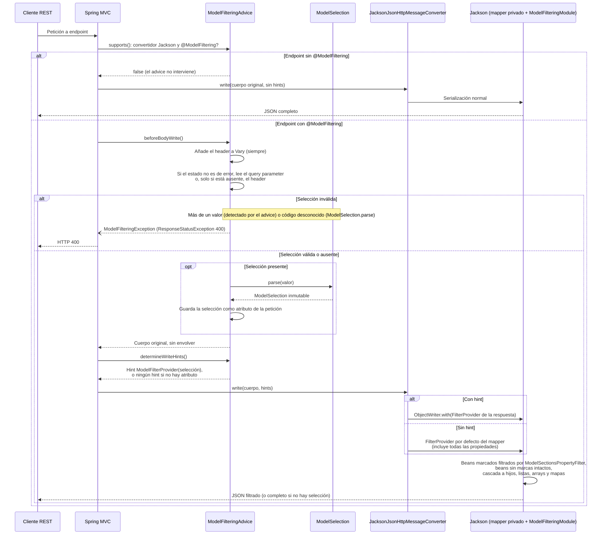

# Arquitectura de filtrado de modelos en respuestas REST

[Català](arquitectura-models-dinamics.md) · [English](arquitectura-models-dinamics.en.md) · **Español**

## 1. Objetivo y alcance

Este documento describe una arquitectura reutilizable para permitir que un consumidor REST seleccione secciones de un DTO JSON mediante códigos compactos. El servicio mantiene un único modelo de respuesta; la selección se aplica durante la serialización.

La arquitectura asume Spring MVC y Jackson, compatible con Java 11 y Spring Boot 2.5.x. No depende de una forma concreta de controller: funciona con un objeto, `ResponseEntity`, colecciones, arrays, mapas, envoltorios de paginación y valores paginados de Spring Data.

> **Spring Boot 4 / Spring Framework 7 / Jackson 3:** el contrato observable (secciones 2, 4, 7 y 9) se mantiene, pero el mecanismo interno de las secciones 3.3–3.6 cambia. Véase la [sección 11](#11-adaptación-a-spring-boot-4-spring-framework-7-y-jackson-3) y [nova-implementacio.es.md](./nova-implementacio.es.md).

El mecanismo es una política de presentación de la respuesta, no un sistema de autorización ni una proyección de consulta. No debe utilizarse para proteger información sensible ni para reducir consultas a base de datos.

## 2. Contrato observable

Se necesitan dos activaciones independientes:

1. La propiedad global `models.filtratge=true` registra la infraestructura MVC.
2. El endpoint o el controlador declara `@ModelFiltering` para adherirse.

En un endpoint activado:

| Selección | Comportamiento |
| --- | --- |
| Ausente del query parameter y del header | No hay filtrado; Jackson devuelve el modelo completo habitual. |
| Presente y vacía | Solo se incluyen propiedades `@ModelBasic` y `@ModelSections` vacías. |
| Uno o más códigos válidos | Se incluyen los datos básicos y las secciones coincidentes. |
| Código desconocido o valor repetido | Error HTTP 400. |

Un endpoint sin `@ModelFiltering` no consulta la selección y conserva el comportamiento normal, aunque la petición contenga un código incorrecto.

La selección se puede enviar como query parameter o como header. Si la petición lleva ambos, el query parameter tiene preferencia y el header se ignora por completo (ni se aplica ni se valida). El header solo se utiliza cuando el query parameter está ausente.

Las reglas existentes de Jackson siguen vigentes: por ejemplo, `NON_NULL`, `JsonIgnore`, vistas, nombres de propiedades y filtros adicionales. Una propiedad básica con valor nulo puede seguir omitida por `NON_NULL`.

## 3. Componentes y responsabilidades

### 3.1 Contrato de anotaciones del modelo

Las anotaciones públicas deben mantenerse independientes de Spring MVC para permitir que los DTO se utilicen en clientes, mensajería u otros módulos sin arrastrar el runtime web.

- `ModelPart`: enumerado de secciones, cada constante con nombre explícito, código estable de una letra y descripción.
- `ModelBasic`: marca una propiedad que siempre se incluye en una respuesta filtrada.
- `ModelSections`: asocia una propiedad a una o más secciones opcionales.
- `ModelFiltering`: opt-in por clase o método; permite cambiar el nombre del query parameter (`queryParam`, por defecto `m`) y del header (`header`, por defecto `X-Model-Sections`).

Regla de combinación de marcas de una propiedad:

| Marca | Selección explícita activa |
| --- | --- |
| `@ModelBasic` | Incluida siempre. |
| `@ModelSections(A, B)` | Incluida cuando la selección contiene `A` **o** `B`. |
| `@ModelSections` sin códigos | Incluida incondicionalmente; se recomienda `@ModelBasic` para campos básicos. |
| Ninguna marca, en un bean con alguna marca | Omitida. |
| Ninguna marca en todo el bean | Se conserva la serialización de todas las propiedades. |

No deben combinarse `@ModelBasic` y `@ModelSections` en una propiedad. La implementación debe detectar esta configuración incorrecta y fallar claramente.

Ejemplo:

```java
public class PersonaResponse {
    @ModelBasic
    private String id;

    @ModelSections(ModelPart.CONTACTE)
    private List<ContacteResponse> contactes;

    @ModelSections({ModelPart.CONTACTE, ModelPart.RELACIONS})
    private String idiomaComunicacio;
}
```

Las marcas se aplican a propiedades Jackson, no a nombres JSON textuales independientes. Hay que establecer una convención de anotación de campo o de accessor y no darles metadatos contradictorios. Si se introduce la primera marca en un DTO, revisar todas sus propiedades: las que queden sin marca pasarán a omitirse cuando el filtro se active.

### 3.2 `ModelSelection`

Es un valor inmutable que transforma el texto de la petición en un conjunto `EnumSet<ModelPart>` una sola vez por respuesta.

- Los códigos repetidos dentro de un solo valor se deduplican (`ccr` equivale a `cr`).
- Mayúsculas y minúsculas no se normalizan.
- Los códigos desconocidos producen una excepción de validación que el advice traduce a 400.
- No contiene dependencias HTTP ni estado mutable compartido.

El nombre `m` o `X-Model-Sections` no forma parte del parser; el advice pasa el valor extraído del transporte.

### 3.3 `ModelFilteringAdvice`

Un `ResponseBodyAdvice` se ejecuta dentro del flujo de serialización MVC, también para `ResponseEntity`. Debe:

1. Limitar `supports()` a los convertidores Jackson y a los endpoints con `@ModelFiltering`.
2. Resolver primero la anotación del método y, si no la hay, la del tipo del controller. Usar las utilidades de anotaciones de Spring para que se contemplen metadatos de interfaces, métodos implementados y superclases.
3. Resolver los nombres del query parameter y del header.
4. Leer el query parameter; solo si está ausente, leer el header. Cuando hay query parameter, el header no se valida.
5. Si el valor está ausente, devolver el cuerpo original sin envolverlo. Esto conserva por completo el camino normal de Jackson.
6. Si está presente, validarlo y envolver el cuerpo en un contenedor equivalente a `MappingJacksonValue` que transporte una instancia inmutable de `ModelSelection`.
7. No sustituir una vista Jackson o un `FilterProvider` que ya vengan dentro de un `MappingJacksonValue`.
8. Preservar las respuestas de error HTTP y añadir el nombre del header a `Vary` en todas las respuestas del endpoint. No eliminar valores `Vary` que ya estén presentes.

El header se añade a `Vary` incluso si está ausente en la petición: la ausencia produce el modelo completo, diferente de un header presente con selección. Esto ayuda a las cachés HTTP a no reutilizar una respuesta incorrecta. Si `Vary: *` ya está presente, no hace falta añadir nada.

### 3.4 `ModelFilteringModule`

Es un módulo Jackson registrado en un `ObjectMapper` privado del convertidor MVC. Un `BeanSerializerModifier` inspecciona las propiedades de cada bean:

1. Si ninguna propiedad tiene `@ModelBasic` ni `@ModelSections`, deja el bean intacto. Esto es esencial para envoltorios de paginación y beans de infraestructura.
2. Si el bean tiene alguna marca, decora todos sus `BeanPropertyWriter`, no solo los anotados.
3. Sin un atributo de selección en el `SerializerProvider`, delega exactamente en Jackson sin filtrar.
4. Con selección, incluye `@ModelBasic`, las secciones vacías y las propiedades con al menos una sección seleccionada; omite las demás propiedades, incluidas las que no tienen marca.
5. No serializa explícitamente los valores omitidos: delega los valores incluidos en el writer original, preservando `NON_NULL` y las demás reglas de Jackson.

La selección se almacena como atributo de un `ObjectWriter` por respuesta. Al serializar una propiedad anidada, Jackson reutiliza el mismo `SerializerProvider`; por tanto, el mismo conjunto de secciones llega recursivamente a los hijos, elementos de listas, arrays y valores de mapas. Un hijo no puede volver a incluir una propiedad padre excluida.

### 3.5 `ModelFilteringConverter`

Decora un `MappingJackson2HttpMessageConverter` existente durante el arranque de MVC:

- Crea una copia del `ObjectMapper` original y registra en ella el módulo de filtrado.
- Delega las lecturas en el convertidor original.
- Delega las escrituras ordinarias en el convertidor original.
- Solo las respuestas con selección se serializan con `ObjectWriter` y atributo de selección.
- Conserva la vista y los filtros de un `MappingJacksonValue` preexistente.
- No cambia ningún mapper compartido durante una petición.

Esta copia localiza el filtrado en MVC; no cambia los mappers de Feign ni la serialización invocada directamente en el resto de la aplicación.

### 3.6 `ModelFilteringConfiguration`

La configuración solo se registra cuando se cumplen todas estas condiciones:

- Classpath con Spring MVC y el convertidor Jackson.
- Aplicación web servlet.
- `models.filtratge=true`.

En Spring Boot 2, la auto-configuración se anuncia en `META-INF/spring.factories`. También se puede ofrecer importación explícita para proyectos con auto-configuración propia. La configuración amplía los convertidores existentes en lugar de añadir un convertidor con prioridad arbitraria.

En una biblioteca compartida, las dependencias web/servlet deben ser opcionales y limitarse al módulo de integración. Los consumidores no web deben poder cargar los DTO sin requerir Spring MVC.

## 4. Selección HTTP

### Query parameter

Por defecto:

```http
GET /persones?m=cr
```

### Header

Por defecto:

```http
GET /persones
X-Model-Sections: cr
```

### Nombres personalizados

La anotación puede cambiar `queryParam` y `header`; cada nombre sustituye por completo su valor por defecto.

### Preferencia

| Query parameter | Header | Selección aplicada |
| --- | --- | --- |
| Ausente | Ausente | Ninguna: modelo completo |
| Ausente | Presente | La del header |
| Presente | Ausente | La del query parameter |
| Presente | Presente | La del query parameter; el header se ignora |

Así, un cliente puede fijar una selección por defecto con el header (por ejemplo, en un interceptor HTTP) y sustituirla puntualmente para una petición concreta con el query parameter.

### Validación

- Un solo valor por origen utilizado. Se rechazan `?m=c&m=r` y, cuando se utiliza el header, headers con más de un valor.
- Los códigos del valor van concatenados, no separados por comas ni espacios.
- Cada carácter debe corresponder exactamente a un código publicado.
- Los códigos repetidos dentro del valor son válidos y se eliminan al construir el conjunto.
- El valor vacío es válido y significa ninguna sección opcional.
- Un código conocido pero sin campos en el DTO de este endpoint es válido y no añade campos.

## 5. Flujo de respuesta

El diagrama corresponde a la implementación actual del proyecto (Spring Boot 4 / Jackson 3, véase la [sección 11](#11-adaptación-a-spring-boot-4-spring-framework-7-y-jackson-3)). La selección no se envuelve con el cuerpo: el advice la guarda como atributo de la petición y la devuelve como hint `FilterProvider` en `determineWriteHints`.



## 6. Integración en otro proyecto

### 6.1 Dependencias

1. Importar el paquete de anotaciones de modelo en el módulo DTO.
2. Añadir Spring MVC / Jackson al servicio web. Si los componentes se publican en una biblioteca común, declarar las dependencias web como opcionales y separarlas de un artefacto de DTO puro cuando la arquitectura lo permita.
3. Verificar la compatibilidad binaria de Spring y Jackson. El diseño expuesto aquí es específico de Spring Boot 2/Spring Framework 5 y `javax.servlet`; Boot 3/Spring 6 requiere adaptar namespaces y el registro de auto-configuración, y validar la API de Jackson.
4. Habilitar `models.filtratge=true` solo en los servicios que quieran cargar la infraestructura.

### 6.2 Auto-configuración

Para Spring Boot 2:

```properties
models.filtratge=true
```

Registrar la configuración en `META-INF/spring.factories` bajo `EnableAutoConfiguration`, y protegerla con condiciones de classpath, servlet web y propiedad. Si no se utiliza Spring Boot o se ha desactivado el descubrimiento, importar la configuración desde la configuración MVC de la aplicación.

### 6.3 Opt-in de endpoints

```java
@RestController
@RequestMapping("/persones")
@ModelFiltering
class PersonaController {
    @GetMapping
    List<PersonaResponse> list() { ... }

    @GetMapping("/{id}")
    @ModelFiltering(queryParam = "seccions", header = "X-Persona-Seccions")
    ResponseEntity<PersonaResponse> get() { ... }
}
```

La segunda anotación sustituye la configuración de clase completa. Por tanto, el segundo endpoint lee `seccions` y `X-Persona-Seccions`, e ignora `m` y `X-Model-Sections`.

### 6.4 Serializadores Jackson preexistentes

Antes de integrarlo, comprobar:

- Orden y tipo de los convertidores registrados por Boot y por configuraciones MVC propias.
- Mappers especializados por tipo de contenido, vistas, filtros y mix-ins.
- Tipos de paginación y envoltorios personalizados que se quieren conservar.
- Respuestas con formatos distintos de JSON, streaming, `Resource`, `String`, XML o mensajes asíncronos.

El decorator debe aplicarse solo a los convertidores Jackson. Hay que probar que la delegación preserva los detalles necesarios del convertidor de la aplicación (prefijo/sufijo JSON, charset, media types o configuración específica). Si estos casos son relevantes, implementar una delegación completa o registrar el módulo en el mapper existente en un punto único e inmóvil, sin mutarlo durante las peticiones.

## 7. Seguridad y cachés

El filtrado solo quita propiedades de la representación. No sustituye comprobaciones de autorización ni la redacción obligatoria de datos. En particular, si `m` está ausente, se devuelve el modelo completo del endpoint; el servicio debe autorizar previamente todo el contenido que puede devolver.

Devolver `Vary: <header>` en todos los endpoints filtrados y configurar CORS si el navegador debe enviar el header. Revisar también las cachés en CDN, proxy y aplicación. Los query parameters normalmente forman parte de la clave de caché, pero hay que comprobar la configuración concreta.

El estado de selección no se guarda en un campo singleton, `ThreadLocal`, `RequestContextHolder` ni en el `ObjectMapper`. Se construye por respuesta y se aplica vía `ObjectWriter`, evitando que peticiones concurrentes se filtren mutuamente.

## 8. Plan de pruebas mínimo

### Parser y anotaciones

- Códigos únicos, explícitos y estables; código válido, desconocido, minúscula y mayúscula.
- Duplicados dentro de un valor, valor vacío y ocurrencias repetidas.
- Propiedad básica, una sección, más de una sección (OR), marca vacía y ninguna marca.
- Rechazar `@ModelBasic` combinado con `@ModelSections`.

### Advice y contrato de endpoint

- Sin propiedad, propiedad falsa y propiedad verdadera.
- Endpoint sin anotación (también con códigos inválidos) y endpoint anotado.
- Anotación en método, clase, interfaz, método de interfaz y superclase.
- Método que sustituye toda la configuración de clase.
- Query parameter, header, preferencia del query parameter cuando están ambos, header inválido ignorado si hay query parameter, nombres personalizados, ausencia, vacío y valor repetido.
- Respuesta de error preservada; `Vary` acumulativo por header.

### Jackson y estructura

- POJO único, `ResponseEntity`, lista, array, mapa, envoltorio propio y `Page`/`PageImpl`.
- Listas anidadas y varios niveles de DTO filtrados recursivamente.
- Bean interno sin marcas, bean marcado parcialmente y propiedades básicas nulas.
- `NON_NULL`, `JsonIgnore`, vistas, `FilterProvider` ya existente, fechas y módulos de tipos específicos.
- Mapper de Feign o mapper externo inalterado.
- Peticiones concurrentes con selecciones diferentes, sin contaminación entre respuestas.

### Contexto de Boot real

Además de `MockMvcBuilders.standaloneSetup`, levantar un contexto real con autoconfiguración para validar el descubrimiento vía `spring.factories`, el orden de los convertidores y la coexistencia con las configuraciones MVC de la aplicación.

## 9. Limitaciones y decisiones conscientes

- La selección tiene semántica OR cuando una propiedad declara varias secciones.
- La propiedad padre debe estar seleccionada para que llegue a serializarse su objeto hijo. Los códigos del hijo no pueden forzar su inclusión.
- Un bean sin marcas conserva todas las propiedades. Por eso los DTO de dominio que necesitan filtrado deben tener al menos una marca; los wrappers técnicos se dejan sin marcas.
- La cascada aplica los mismos códigos en todos los niveles. Si hace falta un contrato diferente por endpoint o por nivel, el parser/modelo de selección debe ampliarse deliberadamente.
- El filtrado ocurre después de cargar y mapear la respuesta; no ahorra IO ni procesamiento.
- La anotación no genera documentación OpenAPI por sí sola. Hay que publicar, por endpoint, los nombres del query parameter y del header y las secciones realmente disponibles.
- Hay que mantener una política explícita de compatibilidad para cambios de códigos, DTO compartidos y versiones de Spring/Jackson.

## 10. Guía de despliegue

1. Publicar la versión de la librería que contiene anotaciones y componentes.
2. Actualizar primero los servicios consumidores sin activar la propiedad; comprobar que los DTO se cargan en contextos no web.
3. Añadir marcas a los DTO y pruebas de contrato.
4. Añadir `@ModelFiltering` solo a los endpoints aprobados.
5. Activar la propiedad en un entorno controlado y probar clientes, OpenAPI, cachés y CORS.
6. Comparar respuestas completas sin selección con la versión anterior: deben ser idénticas según las reglas Jackson existentes.
7. Activar gradualmente los clientes con query o header y monitorizar errores 400 y tamaño de respuesta.
8. No habilitar `models.filtratge` globalmente hasta haber comprobado el orden y la coexistencia de los convertidores del servicio.

## 11. Adaptación a Spring Boot 4, Spring Framework 7 y Jackson 3

Las secciones 3.3–3.6 describen el mecanismo para Spring Boot 2 / Jackson 2. En Spring Boot 4.x el convertidor JSON de MVC es `JacksonJsonHttpMessageConverter`, basado en Jackson 3 (`tools.jackson`), y varias piezas del diseño original ya no son aplicables:

| Diseño original | Problema en Boot 4 | Sustitución |
| --- | --- | --- |
| Envolver el cuerpo en un contenedor equivalente a `MappingJacksonValue` | `MappingJacksonValue` está deprecated y el convertidor de Jackson 3 lo rechaza | `ResponseBodyAdvice.determineWriteHints` devuelve un hint `FilterProvider` por respuesta |
| Atributo de selección en un `ObjectWriter` | `customizeWriter` del convertidor no recibe los hints; habría que duplicar `writeInternal` | El `FilterProvider` del hint lleva la selección; Spring lo aplica con `ObjectWriter.with(filters)` |
| `BeanSerializerModifier` que decora los `BeanPropertyWriter` | API renombrada (`ValueSerializerModifier`) | `AnnotationIntrospector.findFilterId` asigna un filtro solo a los beans marcados; un `PropertyFilter` inmutable decide cada propiedad |
| Decorar `MappingJackson2HttpMessageConverter` | Deprecated (Jackson 2) | `ServerHttpMessageConvertersCustomizer` que registra un `JacksonJsonHttpMessageConverter` con `jsonMapper.rebuild()` + módulo |
| `META-INF/spring.factories` | Formato retirado para auto-configuraciones | `META-INF/spring/org.springframework.boot.autoconfigure.AutoConfiguration.imports` |
| `javax.servlet` | — | `jakarta.servlet` |

Consecuencias sobre los componentes:

- **`ModelFilteringAdvice`**: en `beforeBodyWrite` lee el query parameter o, si está ausente, el header; valida la selección, añade `Vary` y guarda la `ModelSelection` como atributo de la petición (Spring no pasa la petición a `determineWriteHints`). En `determineWriteHints` construye el `FilterProvider` inmutable de la respuesta. El estado queda ligado a la petición, no a ningún singleton, `ThreadLocal` propio ni mapper. Debe llevar `@ControllerAdvice` en la clase, de modo que el paquete de la biblioteca no debe quedar dentro del escaneo de componentes del consumidor.
- **`ModelFilteringModule`**: registra el introspector. Los beans sin marcas no reciben ningún filtro (punto 1 de la sección 3.4). La copia privada del mapper tiene un `FilterProvider` por defecto que deja pasar todas las propiedades, de modo que sin hint la salida es idéntica a la de Jackson (punto 3). El filtro del hint delega los ids que no son suyos al `FilterProvider` existente del mapper, para no romper `@JsonFilter` de la aplicación.
- **Cascada**: el `FilterProvider` es el mismo para todo el grafo del `ObjectWriter`, de modo que la selección llega igualmente a hijos, listas, arrays y mapas.
- **Mapper privado**: el bean `JsonMapper` de Boot y los convertidores de cliente no cambian; solo el convertidor JSON de servidor usa la copia con el módulo.
- **Configuración incorrecta**: un bean marcado con `@JsonFilter` propio, o una propiedad con `@ModelBasic` y `@ModelSections`, falla al construir el serializador con un mensaje que identifica la clase y el miembro.
- **Otros hints**: si otro `ResponseBodyAdvice` aporta también un hint `FilterProvider`, Spring conserva solo uno (el último). Hay que asegurarse de que no haya dos advices compitiendo por el mismo hint en un endpoint filtrado.
